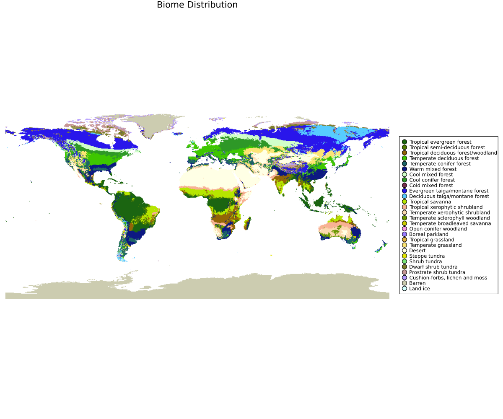

# BIOME4



**Figure.** Example BIOME4-famil| Step | Original BIOME4 | Dominance-mode (Biome.jl) |
|---|---|---|
| 3. Competition | Rule-based comparisons of woody vs. grass PFTs using thresholds on LAI, NPP, fire/greendays, and hand-crafted switches (e.g., temperate evergreen vs. cool conifer; woody-desert fallback; tundra shrub vs. cold herb). | Continuous **scored ranking**: Gaussian fitness around each PFT's niche centre × NPP / `dominance_factor`. Highest score wins; subdominants retained for mixed states. |utput. The NetCDF typically contains `biome` (class id), `optpft` (dominant PFT id), and `npp` (per-PFT) on the model grid.

We offer two ways to run the BIOME4 logic:

---

## 1) Original BIOME4

This path follows an exact translation of the original BIOME core (Haxeltine & Prentice; Kaplan & Prentice). The original Fortran sources by Jed O. Kaplan are available at: https://github.com/jedokaplan/BIOME4

### Inputs (climatologies; aligned grids)

- **Temperature (`pr`)**: °C, monthly means (stacked in the 3rd dimension)  
- **Precipitation (`pr`)**: mm month⁻¹, monthly sums/means (consistent with your decision tree)  
- **Sun/Cloud (`sun` or `clt`)**: % (sunshine or cloudiness surrogate)  
- **Soils (`Ksat`, `whc`)**: saturated conductivity (mm h⁻¹) and water-holding capacity (mm cm⁻¹)  
- **CO₂**: a single ppm value representative of the climatology period  
- **PFT list**: default BIOME4 PFTs, or a customized list

### Outputs

- `biome (lon,lat)`: BIOME4 biome id (Kaplan & Prentice mapping)  
- `optpft (lon,lat)`: id of dominant PFT  
- `npp (lon,lat,pft)`: annual NPP per PFT (same order as `pftlist`)

**Notes**
- Ensure all rasters share the same grid/extent and monthly stacking.  
- Units: pr = °C; pr = mm month⁻¹; sun/clt = %; Ksat = mm h⁻¹; WHC = mm cm⁻¹.  
- CO₂ should match the climatology-period mean.

---

## 2) Dominance-mode (modified competition)

This mode keeps the BIOME4 physiology (environmental sieve → LAI & NPP per PFT) but **modifies the competition** step to rank PFTs by **climate-space dominance** plus productivity.

### Rationale (dominance envelope)

We define a fundamental niche for each PFT ($p$) as a set of admissible intervals $[l_{p,j}, u_{p,j}]$ for key environmental predictors $j$, such as absolute minimum temperature ($t_{min}$), growing degree days ($gdd5, gdd0$), mean warm-month temperature ($t_{wm}$), and maximum snow depth ($maxdepth$).

Bounds may be open ($l_{p,j}=-\infty$ and/or $u_{p,j}=+\infty$). All bounds act as hard presence/absence constraints. Only predictors with **two finite bounds** (excluding `swb`) also contribute to the fitness, because only those define a niche centre and width. PFTs without any two-sided bound therefore have a fitness of 1 wherever they are present.

For each retained predictor $j \in J_p$, the niche centre and width are:

```math
c_{p,j} = \frac{l_{p,j} + u_{p,j}}{2}, \qquad s_{p,j} = 0.25\,(u_{p,j} - l_{p,j})
```

For a grid cell with environmental vector $\mathbf{x}$, the squared standardized distance to the niche centre is:

```math
\Delta_p^2(\mathbf{x}) = \sum_{j \in J_p} \left( \frac{x_j - c_{p,j}}{s_{p,j}} \right)^2
```

An environmental suitability index $S_p(\mathbf{x})$ is derived using a Gaussian kernel, bounded below at 0.01:

```math
S_p(\mathbf{x}) = \max\left( \exp \left( -\tfrac{1}{2} \Delta_p^2(\mathbf{x}) \right),\ 0.01 \right)
```

$S_p = 1$ at the niche centre and $\exp(-2) \approx 0.14$ at a single bound. The kernel has the same shape for every PFT.

The competitive score combines this fitness with the PFT's potential Net Primary Production (NPP), divided by its dominance class $D_p$ (1 = most dominant; values follow Prentice et al., 1992):

```math
C_p(\mathbf{x}) = \frac{\text{NPP}_p(\mathbf{x}) \cdot S_p(\mathbf{x})}{D_p}
```

$D_p$ is used only here. A PFT of class $D_p$ needs $D_p / D_q$ times the fitness-weighted NPP of a PFT of class $D_q$ to dominate it.

When running `BIOMEDominanceModel`, the driver screens the declared niche
predictors separately for each PFT before calculating this score. It uses valid
grid cells inside that PFT's constraints, treats predictors with
`abs(Pearson r) >= 0.7` as collinear, and retains the predictor with the
greater variance. All constraint fields except `swb` are eligible, including
custom fields supplied in a PFT and in the environmental input.


All PFTs present in the grid cell are ranked by this competitive score $C_p$, and the highest-scoring PFT is selected as the dominant type (**optpft**). Sub-dominant woody and grass types are also recorded to capture mixed ecosystem states.

### Outputs

Same schema as the original mode (`biome`, `optpft`, `npp`).  
The **biome** is still assigned using the BIOME4 PFT→biome mapping after dominance is chosen.

---

## What’s different in competition?

At a high level, both modes:

1. **Sieve PFTs** by physiological constraints (e.g., `tmin`, `gdd5/gdd0`, `tcm`, `twm`, `snow max depth`, `site water balance`).  
2. Compute **LAI** and **NPP** for all surviving PFTs.

They diverge at step (3):

| Step | Original BIOME4 | Dominance-mode (Biome.jl) |
|---|---|---|
| 3. Competition | Rule-based comparisons of woody vs. grass PFTs using thresholds on LAI, NPP, fire/greendays, and hand-crafted switches (e.g., temperate evergreen vs. cool conifer; woody-desert fallback; tundra shrub vs. cold herb). | Continuous **scored ranking**: Gaussian fitness around each PFT's niche centre (two-sided bounds of `tcm/tmin/gdd5/gdd0/twm/maxdepth` and custom constraints) × NPP / `dominance_factor`. Highest score wins; subdominants retained for mixed states. |

This preserves BIOME4’s physiology and the environmental sieve, while replacing the final “if/else” winner logic with a continuous dominance score—making it easier to extend to custom PFT sets without rewriting many rule branches.

---

## Output variables (NetCDF)

- Coordinates: `lon`, `lat`  
- **Mechanistic schema**  
  - `biome :: Int16` — BIOME4 biome id  
  - `optpft :: Int16` — dominant PFT id  
  - `npp :: Float64` — shape `(lon, lat, pft)`; includes `num_pfts + 1` slots (default/mixed)
- **Mechanistic scheme: tuning**
  - If you put the model in pft_parametrization mode with `execute(...: pft_parametrization = true)`then the model will skip most ocmputation and return PFT presence right after computing the PFTs climatic enveloppe. Therefore there, the output is `pft_present :: Vector{Int16}`. This will be a binary vector of 1 or 0 representing presence absence.

---

## Minimal troubleshooting

- **Flat/missing output**: check raster alignment/units; inspect the min/max debug prints in the driver.  
- **Everything “NA”**: verify units and that monthly stacks are on the 3rd dimension.  
- **Resume issues**: the driver skips rows where the primary variable (`biome`) already holds non-fill values; remove/rename the outfile to force a clean run.

---

## References

- Haxeltine, A., & Prentice, I. C. (1996). *BIOME3: An equilibrium terrestrial biosphere model based on ecophysiological constraints, resource availability, and competition among plant functional types* Global Biogeochemical Cycles, 10(4), 693–709.
- Kaplan, J. O. (2001). *Geophysical Applications of Vegetation Modeling*.* (Ph.D. thesis), Lund University, Lund, Sweden. doi:10.5281/zenodo.1492908
- Prentice, I. C., Cramer, W., Harrison, S. P., Leemans, R., Monserud, R. A., & Solomon, A. M. (1992). *A Global Biome Model Based on Plant Physiology and Dominance, Soil Properties and Climate.* Journal of Biogeography, 19(2), 117–134.  
- BIOME4 Fortran sources: https://github.com/jedokaplan/BIOME4
